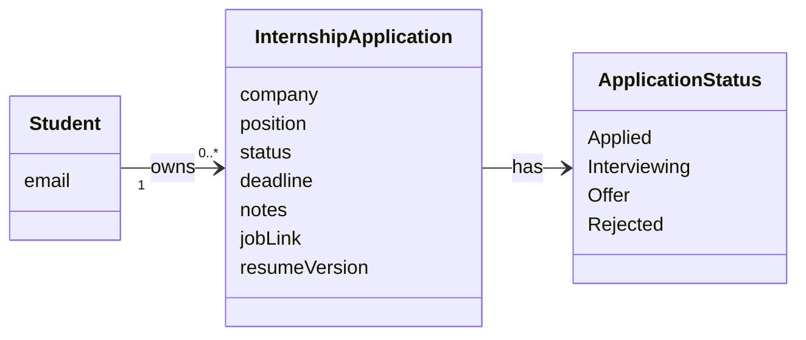
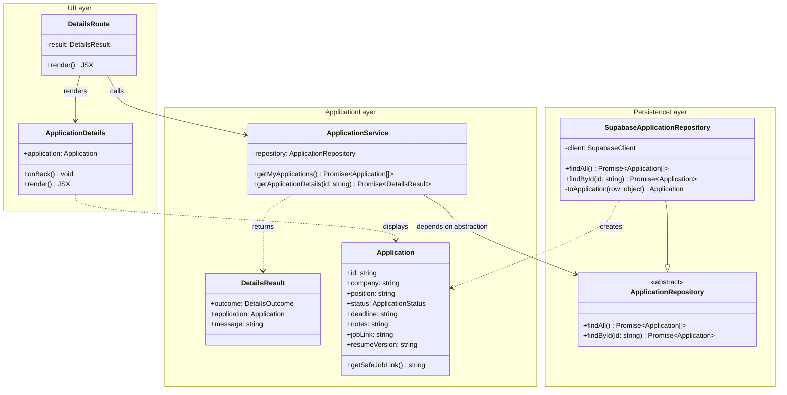
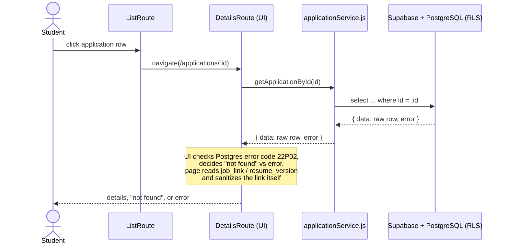
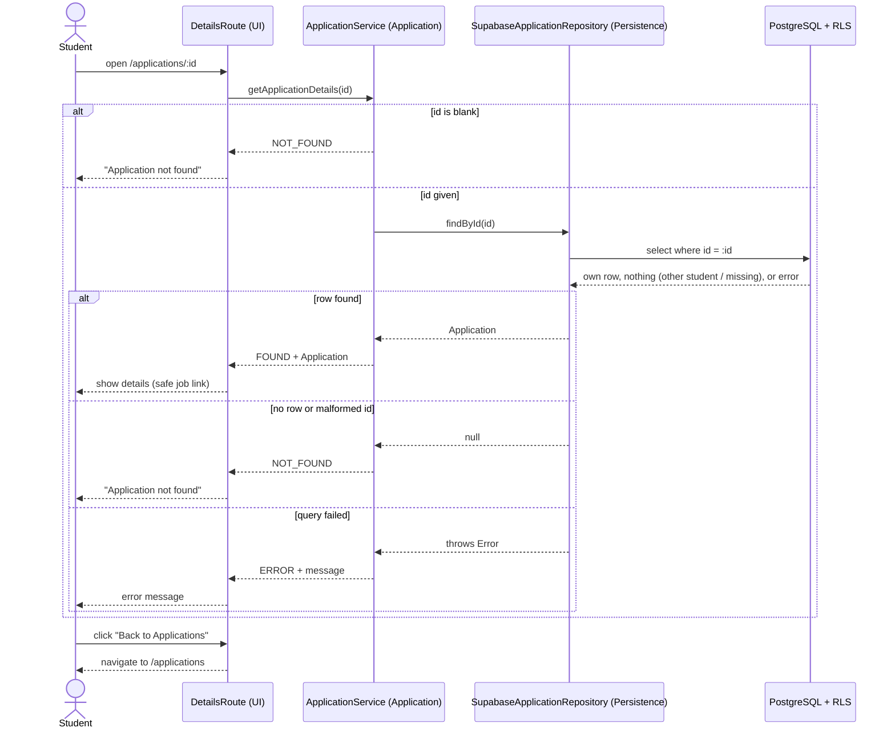

# View Application Details — Design Diagrams (Joseph)

Feature: a logged-in student opens one of their applications from the list, sees its details, and goes back.
Issue: #2 (View Applications Dashboard).

PNG copies of each diagram are in this folder for the Wiki.

Layers: **UI** (React) → **Application** (business logic) → **Persistence** (repository + Supabase/PostgreSQL). Dependencies only point down.

## 1. Conceptual Class Diagram

Real-world things the feature is about (no implementation details).

## 2. Detailed Class Diagram (layered)

`findById` returns `null` when no row is visible to the student.
`DetailsOutcome` is `FOUND | NOT_FOUND | ERROR`.

## 3. Sequence Diagram — Before (reverse-engineered from Sprint 1/2 code)

Problems: database details (error codes, column names) leak into the UI, the link-safety rule lives in a display component, and the service depends directly on Supabase.

## 4. Sequence Diagram — After (layered)

